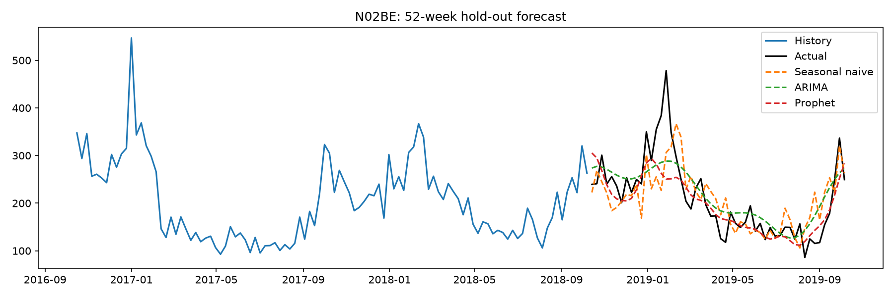
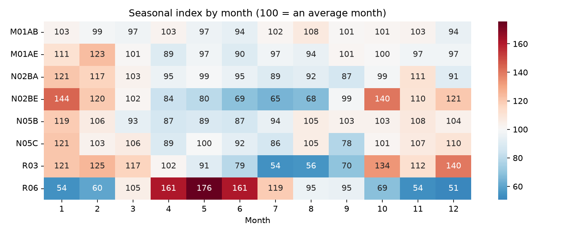
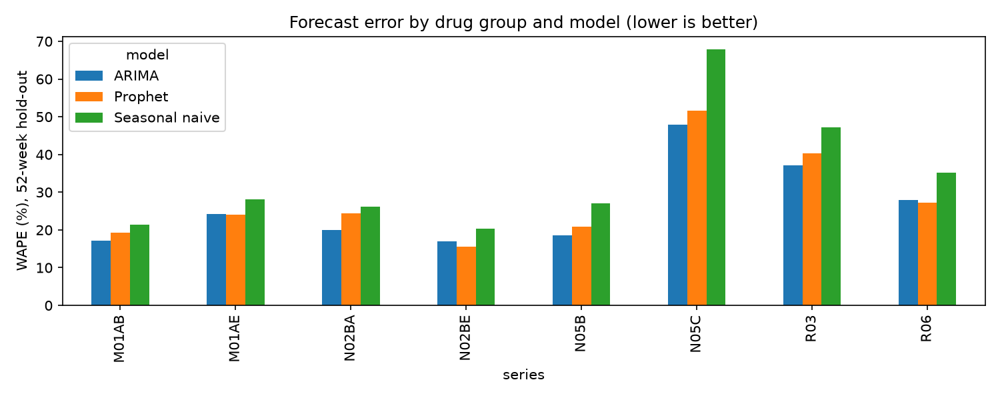

# Pharmacy Sales Forecasting by Drug Group

## Project Overview

How much of each drug group will a pharmacy sell each week over the next year?

This project forecasts weekly sales for 8 ATC drug groups using historical pharmacy sales data. It compares three forecasting approaches: Seasonal Naive, ARIMA, and Prophet.

The objective is to identify seasonal sales patterns, evaluate forecasting accuracy, and generate a 12-week stock planning forecast.

## Tools & Technologies

- Python
- Pandas and NumPy
- Matplotlib and Seaborn
- Statsmodels (SARIMAX)
- Prophet
- Jupyter Notebook

## Key Findings

- ARIMA and Prophet both outperformed the seasonal-naive baseline in all 8 drug groups.
- The best forecasting result was a WAPE of **15.6%**, achieved by Prophet for N02BE.
- N02BE (analgesics, including paracetamol) showed strong seasonal variation.
- Respiratory drug sales showed seasonal patterns consistent with colder months.
- A 12-week forecast was generated for all 8 drug groups to support stock planning.

## Visualisations

### Forecast Comparison

The chart compares historical sales, actual hold-out sales, and the three forecasting approaches for N02BE.



### Seasonal Index by Month

The heatmap shows monthly sales patterns for each drug group. A value of 100 represents the group's average month.



### Forecasting Model Comparison

WAPE comparison across the three forecasting approaches. Lower values indicate better forecasting accuracy.



## Dataset

Source: [Pharma Sales Data – Kaggle](https://www.kaggle.com/datasets/milanzdravkovic/pharma-sales-data)

The project uses weekly sales data grouped into 8 ATC drug categories. The final incomplete week was excluded before analysis.

## Drug Groups

| ATC Code | Drug Group |
|---|---|
| M01AB | Anti-inflammatory drugs – acetic acid derivatives |
| M01AE | Anti-inflammatory drugs – propionic acid derivatives |
| N02BA | Analgesics – salicylic acid derivatives |
| N02BE | Analgesics – anilides |
| N05B | Anxiolytics |
| N05C | Hypnotics and sedatives |
| R03 | Drugs for obstructive airway diseases |
| R06 | Antihistamines for systemic use |

## Methodology

1. Loaded and explored weekly pharmacy sales data.
2. Removed the final incomplete week.
3. Analysed trends and seasonality using seasonal decomposition and monthly seasonal indices.
4. Reserved the final 52 weeks as a hold-out test set.
5. Compared three forecasting approaches:
   - Seasonal Naive baseline
   - ARIMA (1,1,1) with Fourier terms for yearly seasonality
   - Prophet with yearly seasonality
6. Evaluated forecasting performance using WAPE and MAPE.
7. Selected the best-performing model for each drug group.
8. Generated a 12-week stock planning forecast.

## Project Structure

```text
pharma-sales-forecasting/
│
├── data/
│   └── weekly sales dataset
│
├── images/
│   ├── forecast_N02BE.png
│   ├── seasonal_index.png
│   └── wape_by_model.png
│
├── analysis.ipynb
├── stock_plan_next_12_weeks.csv
├── requirements.txt
├── README.md
├── LICENSE
└── .gitignore
```

## How to Run

1. Clone this repository.
2. Install the required dependencies:

```bash
pip install -r requirements.txt
```

3. Launch Jupyter Notebook:

```bash
jupyter notebook
```

4. Open `analysis.ipynb` and run the cells in order.

## Output

The project produces:

- Exploratory sales visualisations.
- Monthly seasonal index heatmap.
- Forecast comparison charts.
- Model performance comparison.
- A 12-week stock planning CSV file.

## Author

Govind Bansal

---

**Govind Bansal** · B.Pharm, BITS Pilani · [LinkedIn](https://www.linkedin.com/in/govind-bansal-42b95441b/) · [GitHub](https://github.com/govindbansal-pixel)
